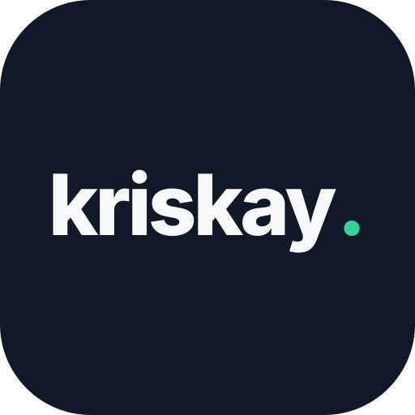

<p align="center">
  
</p>

# Claude Code skills

[](https://github.com/heykriskay/skills/actions/workflows/validate.yml)
[](LICENSE)

This is my personal Claude Code setup, the skills I use every day. Some I wrote myself, and others I
adapted from open-source sets and trimmed to fit how I work. Together they take a feature from
**idea → spec → plan → tested commits → PR**, and nothing gets built or committed without my OK.

Feel free to use them, copy them or change them to fit your own workflow.

## Install

**As a plugin** (easiest, gets updates). In Claude Code:

```
/plugin install kriskay-skills --marketplace heykriskay/skills
```

On Claude Code older than 2.1.275, run `/plugin marketplace add heykriskay/skills` and then
`/plugin install kriskay-skills@heykriskay`.

Skills are then called with a prefix, like `/kriskay-skills:commit`. The plugin includes the skills, agents and lint hook.

**Or copy the files**, if you also want the rules, status line and command log, or prefer plain names like `/commit`:

```bash
git clone https://github.com/heykriskay/skills.git
cd skills && ./install.sh
```

This copies everything into `~/.claude/`. Hooks and the status line need `jq`. Use one way, not both.

## The flow

```
grilling → to-spec → to-plan → execute-plan → pr
```

## Skills

| Skill | What it does |
|---|---|
| `grilling` | Asks you questions until the idea is clear. |
| `to-spec` | Writes a design doc. Waits for your OK. |
| `to-plan` | Splits the spec into small, test-first tasks. |
| `execute-plan` | Builds the plan task by task, one commit each. |
| `test-driven-development` | Write a failing test before any code. |
| `systematic-debugging` | Find the cause before fixing. |
| `verification-before-completion` | No "done" without running the check. |
| `review-since` | Reviews changes against coding standards and the spec. |
| `commit` | Proposes a commit message, commits after your OK. |
| `pr` | Writes the PR description. |
| `handoff` | `/handoff` saves progress for a new session. |
| `hc`, `orchestrate` | Optional: run helper agents in [Herdr](https://github.com/herdrdev/herdr-core). |

Also included: `agents/` (search, implementer, reviewer), `rules/` (Java, shell), `hooks/` (lint and command log),
`statusline.sh`, and example settings in `examples/`.

## Why it works this way

The main choices (approval gates, test-first, two install options) are explained in [docs/decisions](docs/decisions/).

## Contributing

Ideas and fixes are welcome. See [CONTRIBUTING.md](CONTRIBUTING.md); run `./scripts/validate.sh` before opening a PR.

## Credits

Adapted from [mattpocock/skills](https://github.com/mattpocock/skills), [obra/superpowers](https://github.com/obra/superpowers),
[humanlayer/skills](https://github.com/humanlayer/skills) and [herdr-core](https://github.com/herdrdev/herdr-core).
See [THIRD_PARTY_NOTICES.md](THIRD_PARTY_NOTICES.md).

## License

[MIT](LICENSE)
